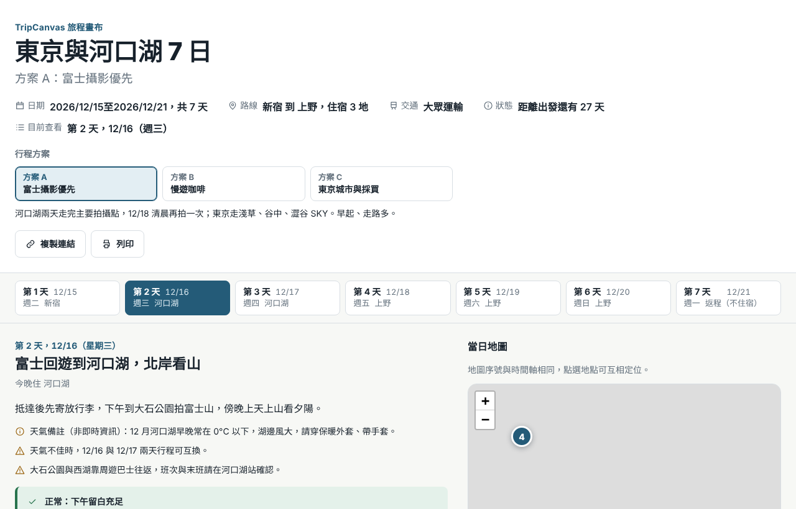

# TripCanvas 旅程畫布

把一趟旅行整理成一個網址：每天的時間軸、地圖、Google Maps 導航、駕車時間提醒、行李與預訂清單。手機和電腦都能看，開過一次之後沒有網路也能讀行程。

網站是純靜態檔案，部署在 GitHub Pages，不需要伺服器、資料庫或任何 API Key。行程內容全部放在一個 JSON 檔，換一趟旅行只需要改這個檔案。



截圖在無法連線地圖服務的環境拍攝，所以地圖只有編號圖釘、沒有底圖；實際網站會顯示 OpenStreetMap 底圖。

## 線上 Demo

部署完成後網址為：

```text
https://{你的 GitHub 帳號}.github.io/travel-planner/
```

第一次部署後請把上面的網址換成實際網址。

## 功能

- 每日時間軸：依時間排序，標示類型（景點、餐飲、住宿、交通、留白、提醒）、費用、預訂狀態。
- 互動地圖：當日地點依序編號，點卡片地圖會定位，點地圖圖釘卡片會捲到眼前。
- 導航：每個有座標的地點都有「導航」按鈕，直接開 Google Maps。
- 行程檢查：每日駕車時間（正常／注意／超過上限）、下午留白是否足夠、連住兩晚的住宿數量。
- 清單：行李、預訂、行前待辦，勾選狀態只存在你自己的瀏覽器。
- 預算：依幣別與類別加總，不同幣別不混算，未填金額另外列出。
- 離線：成功開啟一次後，飛航模式下仍可查看行程文字。
- 分享與列印：分享連結會帶上目前方案與日期（例如 `?plan=b#day-03`），列印版自動隱藏地圖與按鈕。
- 多方案：同一趟旅行可以準備好幾個版本，在頁面上一鍵切換比較。

## 本機開發

需要 Node.js 20 以上。

```bash
npm ci          # 安裝套件（依 package-lock.json 的固定版本）
npm run dev     # 開發伺服器，網址會顯示在終端機，例如 http://localhost:5173/travel-planner/
```

開發模式不會註冊 Service Worker，避免快取干擾修改。

本專案無法直接用 `file://` 開啟 `index.html`：瀏覽器會阻擋 ES Module 與讀取 JSON。請使用 `npm run dev` 或 `npm run preview`。

## Build

```bash
npm run build     # 輸出到 dist/
npm run preview   # 在 http://localhost:4173/travel-planner/ 預覽正式版（含 Service Worker）
```

## 測試

```bash
npm run lint            # ESLint（含禁止 innerHTML 的規則）
npm run validate:data   # 驗證 itinerary.json 與 plans/ 內所有方案
npm run test            # 單元測試（Vitest）
npx playwright install chromium   # 第一次執行 E2E 前安裝瀏覽器
npm run test:e2e        # E2E、響應式、離線與無障礙測試（Playwright + axe）
```

E2E 會自動 build 並啟動 preview server。GitHub Actions 部署流程只跑 lint、資料驗證與單元測試；E2E 建議在本機或另外的 workflow 執行。

## 部署到 GitHub Pages

1. 在 GitHub 建立 repository，建議命名為 `travel-planner`，把本專案推上 `main` 分支。
2. 到 repository 的 **Settings → Pages**，**Source** 選 **GitHub Actions**。
3. 推送到 `main`（或在 Actions 頁手動執行 *Deploy to GitHub Pages*）。完成後 Actions 的部署步驟會顯示網址。

部署後請確認：CSS、JS、`data/itinerary.json`、`manifest.webmanifest`、icons 都沒有 404，重新整理頁面不會白屏。

## 修改 repository 路徑（base path）

GitHub Pages 的 project site 位於 `https://{帳號}.github.io/{repository 名稱}/`，所以網站不能假設自己在網域根目錄。

- **用 GitHub Actions 部署**：不用改任何東西。workflow 會依 repository 名稱自動設定 `BASE_PATH`。
- **其他方式建置**：修改 `vite.config.js` 裡的 `DEFAULT_BASE`，或建置時指定環境變數：

  ```bash
  BASE_PATH=/my-trip/ npm run build
  ```

- **使用自訂網域或 `{帳號}.github.io` 根 repository**：設定 `BASE_PATH=/`。

`playwright.config.js` 也讀取同一個 `BASE_PATH`，本機測試其他路徑時一併設定即可。

## 修改行程：`public/data/itinerary.json`

網站只讀這一個檔案。建議流程：

1. 複製範例檔，改成你的旅行。
2. 執行 `npm run validate:data`，依錯誤訊息修正（會列出所有錯誤與位置，例如 `$.days[2].items[0].endTime`）。
3. `npm run dev` 預覽，確認無誤後推送。

也可以請 AI 依下方欄位說明產生 JSON，再用 `validate:data` 檢查。AI 產生的營業時間、票價與座標仍需自行確認。

## 多方案：同一趟旅行準備好幾個版本

目前專案內附「東京與河口湖 7 日」的三個方案（A 富士攝影優先、B 慢遊咖啡、C 東京城市與採買）。頁面上方的「行程方案」可以切換，切換時會停在同一天，地圖與時間軸一起更新。

### 檔案位置

```text
public/data/
├── itinerary.json        沒有方案清單時使用的預設行程（目前與方案 A 相同）
└── plans/
    ├── index.json        方案清單
    ├── plan-a.json       每個方案都是一份完整的行程，格式與 itinerary.json 相同
    ├── plan-b.json
    └── plan-c.json
```

`plans/index.json` 格式：

```json
{
  "schemaVersion": "1.0",
  "tripId": "tokyo-fuji-2026-12",
  "plans": [
    {
      "id": "a",
      "title": "方案 A：富士攝影優先",
      "shortTitle": "富士攝影優先",
      "description": "切換按鈕下方顯示的說明",
      "file": "plan-a.json"
    }
  ]
}
```

| 欄位 | 必填 | 說明 |
|---|:-:|---|
| `tripId` | 是 | 必須與每個方案檔案的 `trip.id` 相同，清單勾選狀態才會在方案之間共用 |
| `plans[].id` | 是 | 小寫英文、數字或連字號，會出現在網址 `?plan=` |
| `plans[].title` | 是 | 完整名稱，切換後會以螢幕閱讀器宣告 |
| `plans[].shortTitle` | 否 | 按鈕上顯示的短名稱 |
| `plans[].description` | 否 | 選中時顯示在按鈕下方 |
| `plans[].file` | 是 | 同資料夾內的檔名，例如 `plan-d.json` |

### 新增或修改方案

1. 複製一個現有方案，例如把 `plan-a.json` 複製成 `plan-d.json` 再修改內容。
2. 保持 `trip.id` 不變；每天的 `days[].id`（`day-01`、`day-02`…）也建議與其他方案相同，切換方案時才會停在同一天。
3. 在 `index.json` 的 `plans` 加一筆。
4. 執行 `npm run validate:data`。它會驗證 itinerary.json、index.json 與所有方案，並檢查 `trip.id` 是否一致。
5. 推送後自動部署。新增或移除方案會讓網站提示「有新版本可用」，重新載入後新方案也能離線使用。

### 開啟時顯示哪個方案

依序為：網址的 `?plan=`、這台裝置上次選擇的方案、清單中的第一個方案。不存在的方案 id 會被忽略。

### 回到單一行程

刪除 `public/data/plans/` 資料夾即可，網站會改讀 `itinerary.json`，頁面上不顯示方案切換。

### 欄位說明

完整規格見 [SDD.md](SDD.md) 第 4 節。重點如下：

**根物件**

| 欄位 | 必填 | 說明 |
|---|:-:|---|
| `schemaVersion` | 是 | 目前為 `"1.0"` |
| `trip` | 是 | 旅行資訊 |
| `days` | 是 | 每日行程陣列 |
| `checklists` | 否 | 清單 |
| `sources` | 否 | 資料來源，可被 item 的 `sourceIds` 引用 |
| `travelers` | 否 | 保留欄位，請勿放個資 |

**trip**

| 欄位 | 必填 | 說明 |
|---|:-:|---|
| `id` | 是 | 穩定且唯一，例如 `canada-rockies-2027`。清單勾選狀態依此區隔，改了會讓舊勾選失效 |
| `title`、`subtitle` | title 必填 | 標題與副標 |
| `startDate`、`endDate` | 是 | `YYYY-MM-DD`，結束不得早於開始 |
| `timezone` | 是 | IANA 時區，例如 `America/Vancouver`，用來判斷「今天」 |
| `currency` | 是 | 三碼大寫，例如 `CAD` |
| `locale` | 是 | 例如 `zh-TW`，影響日期與金額格式 |
| `transportMode` | 是 | `drive`、`transit`、`walk`、`mixed` |
| `coverImage` | 否 | 相對路徑或 https 網址 |
| `constraints` | 否 | `maxDailyDriveMinutes`、`minAfternoonFreeMinutes`、`afternoonWindow`（`{start, end}`）、`minimumTwoNightBases`、`interests` |

**days[]**

| 欄位 | 必填 | 說明 |
|---|:-:|---|
| `id` | 是 | 例如 `day-01`，也是分享網址的 hash |
| `date` | 是 | 必須在旅行日期內 |
| `title`、`baseCity` | 是 | `baseCity` 是當晚住宿地 |
| `driveMinutes` | 是 | 當日預估駕車分鐘，≥ 0 |
| `distanceKm`、`summary`、`weatherNote`、`notes` | 否 | `weatherNote` 是靜態備註，不是即時天氣 |
| `items` | 是 | 行程項目，順序不拘，網站會依時間排序 |

**items[]**

| 欄位 | 必填 | 說明 |
|---|:-:|---|
| `id` | 是 | 整趟旅行唯一 |
| `type` | 是 | `activity`、`meal`、`lodging`、`transport`、`free-time`、`note` |
| `title` | 是 | |
| `startTime`、`endTime` | 否 | `HH:mm`，結束需晚於開始。沒有時間的項目排在當天最後 |
| `description` | 否 | 純文字 |
| `place` | 否 | `name`（必填）、`address`、`latitude`、`longitude`、`googleMapsUrl`、`websiteUrl`、`image`、`lastVerifiedAt`。沒有座標就不會出現在地圖上 |
| `cost` | 否 | `amount`（未知填 `null`）、`currency`、`category`、`status`（`estimated`、`confirmed`、`paid`、`unknown`） |
| `booking` | 否 | `status`（`confirmed`、`pending`、`not-required`）、`provider`、`note`。不要放確認碼 |
| `tags`、`locked`、`sourceIds` | 否 | 交通項目的 tags 含 `flight`／`airport` 顯示飛機圖示，含 `train`／`shuttle`／`bus` 顯示列車圖示 |

**checklists[]**：`id`、`title`、`scope`（`trip` 或 `day`）、`items[]`（`id`、`label`、`category`、`required`）。

**sources[]**：`id`、`title`、`url`（https）、`accessedAt`。

### 資料新鮮度

`place.lastVerifiedAt` 會顯示為「資料驗證日期」，超過 90 天加註「建議重新確認」。網站不提供即時營業時間、票價、路況或天氣。

## PWA 與快取更新

- 第一次開啟時，Service Worker 會快取頁面、CSS、JS、icons 與 `itinerary.json`。
- `data/` 內的 JSON（`itinerary.json` 與所有方案）採 Network First：有網路時永遠讀最新版，離線才用快取。所以**只修改行程資料時，使用者重新整理就會看到新內容**。
- 安裝時會預先快取方案清單列出的所有方案，離線時也能切換到從未開啟過的方案。
- 程式或樣式更新後，每次 build 會產生新的快取版本。使用者下次開啟時會看到「有新版本可用」，按下才重新載入，不會在查看行程時被強制刷新。
- 地圖底圖（OpenStreetMap）與 Google Maps 不會被快取，離線時地圖可能空白，但時間軸與地點清單仍可使用。
- 若需要手動清除：瀏覽器開發者工具 → Application → Storage → Clear site data。

## 隱私提醒：GitHub Pages 是公開的

公開 repository 的程式碼與網站，任何人都能看到；即使是私人 repository，GitHub Pages 網站本身通常仍可公開存取，**它不是存取控制工具**。

上傳前請移除：

- 護照號碼、身分證字號
- 訂房確認碼、機票票號
- 旅伴的 email、電話
- 住家或住宿的精確地址（可只寫城市）
- API Key、信用卡或付款資訊

尚未出發的住宿地點也可能透露你何時不在家，請評估是否公開。清單勾選狀態只存在你的瀏覽器，不會上傳或出現在分享網址中。

## 安全性說明

- JSON 內容一律以文字方式插入畫面，不使用 `innerHTML`（ESLint 規則會擋）。
- 外部連結只接受 `https:`，並使用 `rel="noopener noreferrer"` 開新分頁。
- 正式版以 `<meta>` 加入 Content Security Policy。GitHub Pages 無法自訂 HTTP header，因此 `frame-ancestors` 等只能透過 header 設定的規則無法生效。
- 所有套件版本固定，並提交 `package-lock.json`。

## 地圖資料與使用限制

- 底圖來自 [OpenStreetMap](https://www.openstreetmap.org/copyright)，© OpenStreetMap contributors，以 ODbL 授權。頁面已顯示 attribution，請勿移除。
- 本專案直接使用 OSM 官方 tile server，須遵守其 [Tile Usage Policy](https://operations.osmfoundation.org/policies/tiles/)：適合個人與低流量使用，不得大量預先下載或離線打包 tiles。若網站流量大，請改用商業 tile 供應商並修改 `src/config.js` 的 `TILE_URL` 與 `TILE_ATTRIBUTION`。
- 地圖函式庫為 [Leaflet](https://leafletjs.com/)（BSD-2-Clause）。
- 導航使用 [Google Maps URLs](https://developers.google.com/maps/documentation/urls/get-started)，不需要 API Key。

## 專案結構

```text
public/            直接複製到網站根目錄的檔案（行程 JSON、icons、manifest、Service Worker）
src/data/          載入、驗證、排序、限制檢查、預算計算
src/components/    畫面元件（header、日期、時間軸、地圖、清單…）
src/services/      導航網址、LocalStorage、PWA、分享
src/utils/         日期、貨幣、DOM、URL 檢查
tests/             單元測試；tests/e2e 為 Playwright 測試；tests/fixtures 為測試用的加拿大範例資料
scripts/           validate-data.js
```

## 授權

MIT，見 [LICENSE](LICENSE)。
