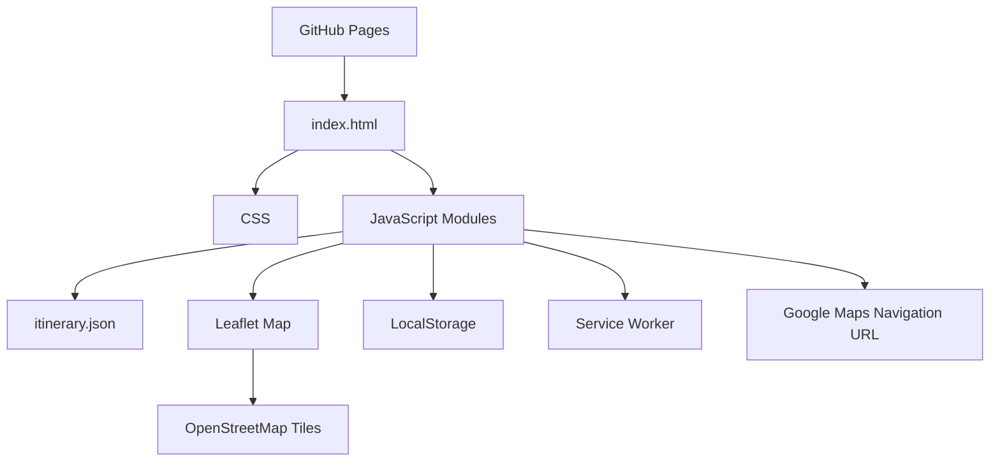
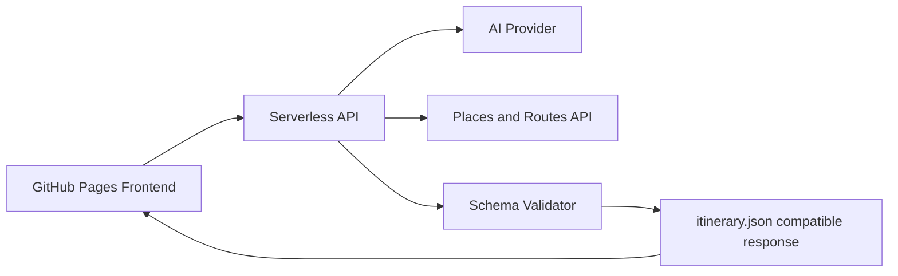

# Travel Planner 靜態旅行規劃網站 SDD

> 文件版本：1.0  
> 建立日期：2026-11-17  
> 目標平台：GitHub Pages  
> 目標裝置：手機、平板、桌面瀏覽器  
> 開發模式：Static Web App / PWA  
> 預設語言：繁體中文（zh-TW）  
> 本文件用途：提供 coding agent 直接建立、驗證及部署專案

---

## 0. Agent 執行指令

你是一名資深 Frontend Engineer、UX Engineer 與 QA Engineer。請依本 SDD 建立一個可直接部署至 GitHub Pages 的旅行規劃網站。

### 0.1 最終成果

完成後必須具備：

1. 手機與電腦皆可正常使用的 Responsive Web Design。
2. 每日行程時間軸。
3. 景點、餐廳、住宿、交通與留白時間分類。
4. 互動地圖與每日景點圖釘。
5. Google Maps 導航連結。
6. 每日駕車時間與限制警示。
7. 行李、預訂及待辦清單。
8. LocalStorage 保存個人勾選狀態。
9. PWA 安裝與離線讀取已發布行程。
10. GitHub Pages 可正常部署，包含 repository 子路徑情境。

### 0.2 重要邊界

- 第一版不得串接 AI API。
- 第一版不得建立後端、資料庫或登入系統。
- 不得把任何 API Key、Token 或密碼寫入前端。
- 不得要求使用者安裝 Node.js 才能瀏覽成品。
- 網站執行時不得依賴付費服務。
- 行程資料必須與 UI 程式碼分離。
- 不得把行程內容大量寫死在 HTML。
- 未在本文件定義的功能不得自行擴張。
- 若某項需求無法完全實作，先完成降級方案並在 README 說明，不得留下無法啟動的專案。

### 0.3 建議執行順序

1. 建立檔案與目錄。
2. 建立資料 Schema 與範例資料。
3. 建立語意化 HTML 結構。
4. 完成 Mobile-first CSS。
5. 完成資料載入及畫面渲染。
6. 完成時間軸與每日切換。
7. 完成地圖。
8. 完成 LocalStorage。
9. 完成 PWA。
10. 完成測試、README 與 GitHub Pages workflow。
11. 執行完整驗收，不得只確認首頁能開啟。

---

## 1. 產品摘要

### 1.1 產品名稱

暫定名稱：**TripCanvas 旅程畫布**

### 1.2 產品定位

TripCanvas 是一個以單次旅行為單位的靜態旅行規劃網站。使用者透過一個網址，即可在手機或電腦查看每天的時間軸、景點、住宿、餐廳、交通、地圖、導航與旅行清單。

第一版以「展示與旅途中查看」為核心，不在網站內自動生成行程。AI 可在網站外協助產生符合 Schema 的 `itinerary.json`，再由網站讀取並呈現。

### 1.3 問題陳述

一般旅行資訊經常分散於：

- Google Maps 收藏。
- 聊天訊息。
- Excel 或 Google Sheets。
- 訂房與交通確認信。
- 社群貼文與截圖。
- 紙本或手機備忘錄。

本產品將上述資訊整理成一個 Mobile-first、可分享、可離線查看的旅行頁面。

### 1.4 目標

- 透過 GitHub Pages 免費託管。
- 不需要伺服器即可運作。
- 使用者能在 30 秒內理解今日行程。
- 每個地點最多兩次點擊即可開啟導航。
- 網路中斷後仍能查看最近成功載入的行程。
- 行程資料修改時，原則上只需調整 JSON。

### 1.5 非目標

第一版不包含：

- AI 自動生成行程。
- 即時搜尋景點。
- 自動取得最新營業時間。
- 自動計算即時車程。
- 多人同步編輯。
- Google 登入。
- 訂房、付款或機票開票。
- 後端資料庫。
- Email 或 PDF 自動解析。
- 社群動態牆。

---

## 2. 技術架構

### 2.1 架構決策

本專案採用純前端 Static Web App：



### 2.2 技術選型

| 類別 | 選型 | 說明 |
|---|---|---|
| Markup | HTML5 | 使用語意化標籤 |
| Style | CSS3 | Mobile-first、CSS Custom Properties |
| Logic | Vanilla JavaScript ES Modules | 不需要 framework runtime |
| Data | JSON | 與畫面程式分離 |
| Map | Leaflet | 輕量、容易在 Static Hosting 使用 |
| Base Map | OpenStreetMap | 顯示 attribution；不得大量離線下載 tiles |
| Navigation | Google Maps URL | 不需要 Google Maps API Key |
| Storage | LocalStorage | 保存 checklist、偏好與目前選擇日期 |
| Offline | Service Worker + Cache Storage | 快取 App Shell 與行程資料 |
| Hosting | GitHub Pages | 支援 repository project pages |
| Testing | Vitest 或 Node test + Playwright | 若使用 build tool，輸出仍須為純靜態檔案 |

### 2.3 是否使用 Build Tool

優先採用 Vite，以利模組化、測試、資源路徑處理及開發體驗。

如果使用 Vite：

- `base` 必須根據 GitHub repository 名稱設定。
- Production build 輸出為 `dist/`。
- GitHub Actions 部署 `dist/`。
- 不可要求 production server。

若選擇完全無 build 版本：

- 所有路徑必須使用相對路徑。
- 必須可由簡單 HTTP server 啟動。
- 不支援直接以 `file://` 開啟，README 必須說明原因。

### 2.4 瀏覽器支援

- Android Chrome：最近兩個主要版本。
- iOS Safari：最近兩個主要版本。
- Desktop Chrome、Edge、Firefox、Safari：最近兩個主要版本。
- 不支援 Internet Explorer。

---

## 3. 專案目錄

Agent 應建立下列結構；若使用 TypeScript，可將 `js/` 改為 `src/`，但模組責任不得混合。

```text
travel-planner/
├── .github/
│   └── workflows/
│       └── deploy-pages.yml
├── public/
│   ├── data/
│   │   └── itinerary.json
│   ├── icons/
│   │   ├── icon-192.png
│   │   └── icon-512.png
│   ├── images/
│   │   └── placeholders/
│   ├── manifest.webmanifest
│   └── service-worker.js
├── src/
│   ├── main.js
│   ├── app.js
│   ├── config.js
│   ├── styles/
│   │   ├── tokens.css
│   │   ├── base.css
│   │   ├── layout.css
│   │   └── components.css
│   ├── data/
│   │   ├── itinerary-loader.js
│   │   ├── schema-validator.js
│   │   └── normalizer.js
│   ├── components/
│   │   ├── trip-header.js
│   │   ├── day-selector.js
│   │   ├── timeline.js
│   │   ├── itinerary-card.js
│   │   ├── map-view.js
│   │   ├── checklist.js
│   │   ├── warning-panel.js
│   │   └── offline-banner.js
│   ├── services/
│   │   ├── navigation.js
│   │   ├── storage.js
│   │   ├── pwa.js
│   │   └── share.js
│   └── utils/
│       ├── date.js
│       ├── currency.js
│       ├── dom.js
│       └── sanitize.js
├── tests/
│   ├── schema-validator.test.js
│   ├── navigation.test.js
│   ├── storage.test.js
│   └── e2e/
│       └── core-flow.spec.js
├── index.html
├── package.json
├── vite.config.js
├── README.md
├── LICENSE
└── SDD.md
```

---

## 4. 資料設計

### 4.1 資料來源

網站預設從以下相對路徑讀取行程：

```text
./data/itinerary.json
```

不得在 JavaScript 中複製一份相同行程資料。

### 4.2 Root Schema

```json
{
  "schemaVersion": "1.0",
  "trip": {},
  "travelers": [],
  "days": [],
  "checklists": [],
  "sources": []
}
```

### 4.3 Trip

| 欄位 | 型別 | 必填 | 說明 |
|---|---|---:|---|
| `id` | string | 是 | 穩定且唯一，例如 `canada-rockies-2027` |
| `title` | string | 是 | 旅行名稱 |
| `subtitle` | string | 否 | 簡短說明 |
| `startDate` | ISO date | 是 | `YYYY-MM-DD` |
| `endDate` | ISO date | 是 | 不得早於 startDate |
| `timezone` | IANA string | 是 | 例如 `America/Vancouver` |
| `currency` | string | 是 | ISO 4217，例如 `CAD` |
| `locale` | string | 是 | 預設 `zh-TW` |
| `coverImage` | string | 否 | 相對路徑或 HTTPS URL |
| `transportMode` | enum | 是 | `drive`, `transit`, `walk`, `mixed` |
| `constraints` | object | 否 | 全旅程限制 |

### 4.4 Constraints

```json
{
  "maxDailyDriveMinutes": 240,
  "minAfternoonFreeMinutes": 60,
  "afternoonWindow": {
    "start": "13:00",
    "end": "17:00"
  },
  "minimumTwoNightBases": 2,
  "interests": ["photography", "local-food", "cafe"]
}
```

### 4.5 Day

| 欄位 | 型別 | 必填 | 說明 |
|---|---|---:|---|
| `id` | string | 是 | 例如 `day-01` |
| `date` | ISO date | 是 | 必須在旅行日期內 |
| `title` | string | 是 | 當日標題 |
| `baseCity` | string | 是 | 當晚住宿基地 |
| `summary` | string | 否 | 當日摘要 |
| `weatherNote` | string | 否 | 靜態備註，不宣稱即時 |
| `driveMinutes` | number | 是 | 當日預估駕車分鐘數 |
| `distanceKm` | number | 否 | 當日預估距離 |
| `items` | array | 是 | 時間順序排列 |
| `notes` | array | 否 | 當日提醒 |

### 4.6 Itinerary Item

| 欄位 | 型別 | 必填 | 說明 |
|---|---|---:|---|
| `id` | string | 是 | 全 Trip 唯一 |
| `type` | enum | 是 | `activity`, `meal`, `lodging`, `transport`, `free-time`, `note` |
| `startTime` | HH:mm | 否 | note 可省略 |
| `endTime` | HH:mm | 否 | 若有 startTime 則應提供 |
| `title` | string | 是 | 顯示名稱 |
| `description` | string | 否 | 純文字，不接受未清理 HTML |
| `place` | object | 否 | 地點資料 |
| `cost` | object | 否 | 預估成本 |
| `booking` | object | 否 | 預訂狀態，不放敏感確認碼 |
| `tags` | string[] | 否 | 類型與偏好標記 |
| `locked` | boolean | 否 | 已預訂或不可移動 |
| `sourceIds` | string[] | 否 | 對應 sources |

### 4.7 Place

```json
{
  "name": "Lake Louise",
  "address": "Lake Louise, AB, Canada",
  "latitude": 51.4254,
  "longitude": -116.1773,
  "googleMapsUrl": "https://www.google.com/maps/search/?api=1&query=51.4254,-116.1773",
  "websiteUrl": "https://example.com",
  "image": "./images/lake-louise.webp",
  "lastVerifiedAt": "2026-11-17"
}
```

規則：

- `latitude` 必須介於 -90 至 90。
- `longitude` 必須介於 -180 至 180。
- 外部網址只允許 `https:`。
- 若沒有 `googleMapsUrl`，由 `latitude`、`longitude` 產生導航 URL。
- 若座標不存在，不可顯示假的圖釘。

### 4.8 Cost

```json
{
  "amount": 45,
  "currency": "CAD",
  "category": "meal",
  "status": "estimated"
}
```

`status` 可為：

- `estimated`
- `confirmed`
- `paid`
- `unknown`

### 4.9 Checklist

```json
{
  "id": "packing-main",
  "title": "行李清單",
  "scope": "trip",
  "items": [
    {
      "id": "passport",
      "label": "護照",
      "category": "documents",
      "required": true
    }
  ]
}
```

勾選狀態不得寫回 JSON，必須存入 LocalStorage。

### 4.10 完整範例資料

```json
{
  "schemaVersion": "1.0",
  "trip": {
    "id": "canada-rockies-2027",
    "title": "加拿大洛磯與溫哥華",
    "subtitle": "10 天 9 夜自駕旅行",
    "startDate": "2027-09-15",
    "endDate": "2027-09-24",
    "timezone": "America/Vancouver",
    "currency": "CAD",
    "locale": "zh-TW",
    "transportMode": "drive",
    "constraints": {
      "maxDailyDriveMinutes": 240,
      "minAfternoonFreeMinutes": 60,
      "minimumTwoNightBases": 2,
      "interests": ["photography", "local-food", "cafe"]
    }
  },
  "travelers": [],
  "days": [
    {
      "id": "day-01",
      "date": "2027-09-15",
      "title": "抵達卡加利前往班夫",
      "baseCity": "Banff",
      "summary": "取車後以低強度行程開始旅程",
      "driveMinutes": 110,
      "distanceKm": 145,
      "items": [
        {
          "id": "day-01-airport",
          "type": "transport",
          "startTime": "10:00",
          "endTime": "11:30",
          "title": "抵達卡加利機場與取車",
          "locked": true,
          "tags": ["airport", "rental-car"]
        },
        {
          "id": "day-01-drive-banff",
          "type": "transport",
          "startTime": "12:00",
          "endTime": "13:50",
          "title": "開車前往班夫",
          "place": {
            "name": "Banff",
            "address": "Banff, AB, Canada",
            "latitude": 51.1784,
            "longitude": -115.5708,
            "googleMapsUrl": "https://www.google.com/maps/search/?api=1&query=51.1784,-115.5708",
            "lastVerifiedAt": "2026-11-17"
          }
        },
        {
          "id": "day-01-free-time",
          "type": "free-time",
          "startTime": "15:00",
          "endTime": "16:00",
          "title": "飯店休息與彈性時間"
        }
      ],
      "notes": ["山區天氣可能快速變化，出發前再次確認路況"]
    }
  ],
  "checklists": [
    {
      "id": "packing-main",
      "title": "行李清單",
      "scope": "trip",
      "items": [
        {
          "id": "passport",
          "label": "護照",
          "category": "documents",
          "required": true
        }
      ]
    }
  ],
  "sources": []
}
```

---

## 5. 功能需求

### FR-001 載入行程資料

系統必須從 JSON 載入行程並驗證必要欄位。

驗收條件：

- 成功時顯示旅行標題與日期。
- JSON 404 時顯示可理解的錯誤頁。
- JSON 格式錯誤時不得讓整頁白屏。
- Console 可記錄技術細節，畫面只顯示使用者可理解訊息。

### FR-002 旅行摘要

首頁頂部顯示：

- 旅行名稱。
- 日期區間與總天數。
- 起訖城市或摘要。
- 主要交通模式。
- 目前選擇日。
- 距離出發日的狀態；已開始或已結束時使用不同文字。

### FR-003 每日選擇器

- Desktop 顯示左側或上方日期導覽。
- Mobile 顯示可水平捲動的日期 chips。
- 選中日期必須具有 `aria-current="date"`。
- 重新整理後，從 LocalStorage 恢復上次選擇日。
- URL hash 可選用 `#day-03`，以支援分享指定日期。

### FR-004 每日時間軸

每個項目顯示：

- 開始與結束時間。
- 類型 icon 與文字。
- 標題。
- 簡短描述。
- 地點與地址。
- 預估費用。
- 鎖定或已預訂標示。
- 導航、官網等操作按鈕。

排序規則：

1. 有時間項目依 `startTime` 升冪。
2. 無時間 note 放在當日末尾。
3. 原始 JSON 不得被 `sort()` 原地修改。

### FR-005 地圖

- 使用 Leaflet 顯示當日有座標的地點。
- 切換日期時更新 markers。
- marker 順序與當日時間軸順序一致。
- marker popup 顯示序號、名稱、時間與導航按鈕。
- 點擊行程卡片時，地圖聚焦對應 marker。
- 點擊 marker 時，對應卡片需被選中並捲動至可視區域。
- 沒有座標時顯示空狀態，不顯示世界地圖誤導使用者。
- 顯示 OpenStreetMap attribution。

### FR-006 Google Maps 導航

導航 URL 規則：

```text
https://www.google.com/maps/dir/?api=1&destination={latitude},{longitude}
```

若已有安全的 `googleMapsUrl`，可優先使用。

驗收條件：

- 連結使用新分頁開啟。
- 包含 `rel="noopener noreferrer"`。
- 座標必須經型別與範圍驗證。
- 無座標及無合法 URL 時不顯示導航按鈕。

### FR-007 駕車時間警示

- 顯示當日 `driveMinutes`。
- 若大於 `maxDailyDriveMinutes`，顯示 Blocker。
- 若達上限 80% 以上，顯示 Warning。
- 否則顯示 Normal。
- 不得只以顏色區分，必須搭配 icon 及文字。

### FR-008 留白時間檢查

若設定 `minAfternoonFreeMinutes`：

- 計算下午窗口內 `free-time` 的總分鐘數。
- 不足時顯示提醒。
- 只作靜態驗證，不自動修改行程。

### FR-009 Checklist

- 顯示行李、預訂與一般待辦清單。
- 勾選狀態立即寫入 LocalStorage。
- 依 Trip ID 區隔 storage key。
- 顯示已完成數量與百分比。
- 提供「清除本機勾選狀態」，操作前必須確認。

### FR-010 預算摘要

- 加總具有 `cost.amount` 的項目。
- 依 category 彙整。
- 不同 currency 不得直接相加。
- 未知金額顯示「尚未提供」，不得當成 0 元。

### FR-011 離線模式

快取內容：

- App Shell。
- CSS、JavaScript 與 icons。
- `itinerary.json`。
- 本地圖片。
- Leaflet 必要靜態資源。

不保證快取：

- OpenStreetMap tiles。
- Google Maps。
- 第三方網站。

離線時：

- 顯示 Offline banner。
- 可查看最近成功載入的行程。
- 外部導航按鈕可保留，但要提示需要網路。

### FR-012 分享

- 提供複製目前頁面 URL。
- 若選中日期，URL 應包含 hash。
- `navigator.share` 可用時顯示原生分享。
- 不可把個人 checklist 勾選狀態加入 URL。

### FR-013 列印

- 提供 Print 按鈕。
- `@media print` 隱藏地圖控制、導覽列與非必要按鈕。
- 每日內容應避免卡片被不合理切半。
- 列印版顯示網址產生日期可選，但不得顯示敏感資訊。

### FR-014 錯誤與空狀態

至少處理：

- 無 days。
- 某日無 items。
- 地點無座標。
- 圖片載入失敗。
- JSON 載入失敗。
- Service Worker 不支援或註冊失敗。
- LocalStorage 不可用。

### FR-015 資料新鮮度

- 若 `lastVerifiedAt` 存在，顯示「資料驗證日期」。
- 超過 90 天可顯示「建議重新確認」。
- 不可宣稱網站提供即時營業、票價、交通或天氣資訊。

---

## 6. UX 與畫面規格

### 6.1 Information Architecture

單頁應用區塊：

```text
App
├── Skip Link
├── Header
│   ├── Trip Summary
│   ├── Online Status
│   └── Share / Print
├── Day Selector
├── Main
│   ├── Day Summary
│   ├── Constraint Warnings
│   ├── Timeline
│   └── Map
├── Checklist Drawer or Section
├── Budget Summary
└── Footer
    ├── Data Disclaimer
    └── Map Attribution
```

### 6.2 Desktop Layout

- 建議 breakpoint：`min-width: 960px`。
- 左側時間軸約 55–60%。
- 右側地圖約 40–45%。
- 地圖可使用 `position: sticky`，但不得遮住 footer。
- 最大內容寬度建議 1440 px。

### 6.3 Mobile Layout

- 360 px 寬度必須正常。
- 單欄呈現。
- Day selector 可水平捲動。
- Map 與 Timeline 可上下排列，或使用 tab 切換。
- 底部可放 Today、Map、Checklist 三個主要操作。
- 所有觸控目標至少 44×44 CSS px。

### 6.4 視覺系統

建議使用自然、安靜且適合旅行照片的色系：

```css
:root {
  --color-bg: #f7f8f5;
  --color-surface: #ffffff;
  --color-text: #17212b;
  --color-muted: #64717d;
  --color-primary: #245b78;
  --color-primary-contrast: #ffffff;
  --color-border: #d8dee3;
  --color-success: #27734d;
  --color-warning: #9a6410;
  --color-danger: #a33a32;
  --radius-sm: 8px;
  --radius-md: 14px;
  --shadow-card: 0 8px 24px rgb(20 35 45 / 8%);
}
```

要求：

- 正文對比符合 WCAG AA。
- 不使用純裝飾性過度動畫。
- 支援 `prefers-reduced-motion`。
- 不使用過量玻璃模糊導致可讀性下降。

### 6.5 行程類型

每一類型需同時有 icon、標籤與顏色：

| Type | 中文 | 建議 icon |
|---|---|---|
| activity | 景點／活動 | camera 或 landmark |
| meal | 餐飲 | utensils |
| lodging | 住宿 | bed |
| transport | 交通 | car / train / plane |
| free-time | 留白 | coffee 或 clock |
| note | 提醒 | info |

### 6.6 Accessibility

- 首個可聚焦元素為 Skip to content。
- 使用 `header`, `nav`, `main`, `section`, `article`, `footer`。
- 所有 icon button 提供 accessible name。
- 地圖不是唯一資訊來源。
- Keyboard 可切換日期、開啟卡片與操作 checklist。
- Focus indicator 清楚可見。
- 動態狀態以 `aria-live="polite"` 宣告。
- 圖片具有有意義的 `alt`；純裝飾圖使用空 alt。
- 不使用 `<div>` 模擬 button。

---

## 7. JavaScript 模組責任

### 7.1 itinerary-loader

責任：

- Fetch JSON。
- 檢查 HTTP status。
- 呼叫 schema validator。
- 回傳 immutable 或 defensive copy 資料。

建議介面：

```javascript
/**
 * @param {string} url
 * @returns {Promise<TripDocument>}
 */
export const loadItinerary = async (url) => {};
```

### 7.2 schema-validator

責任：

- 驗證 Root、Trip、Day、Item。
- 回傳所有錯誤，不只第一個錯誤。
- 錯誤包含 path、code、message。

```javascript
/**
 * @param {unknown} value
 * @returns {{ valid: boolean, errors: ValidationError[] }}
 */
export const validateTripDocument = (value) => {};
```

### 7.3 storage

Storage namespace：

```text
tripcanvas:{tripId}:selected-day
tripcanvas:{tripId}:checklist
tripcanvas:{tripId}:preferences
tripcanvas:app-version
```

要求：

- JSON parse 失敗時安全回復預設值。
- 捕捉 quota 或 privacy mode 錯誤。
- 不保存精確位置、訂單編號或個資。

### 7.4 navigation

```javascript
/**
 * @param {number} latitude
 * @param {number} longitude
 * @returns {string}
 */
export const createGoogleMapsDirectionsUrl = (
  latitude,
  longitude,
) => {};
```

驗證非法輸入時應 throw `TypeError`，呼叫端負責不顯示按鈕。

### 7.5 map-view

責任：

- 初始化 Leaflet map 一次。
- 日期切換時清除並重建當日 Layer Group。
- 維持 itemId 與 marker 的 Map。
- 適當呼叫 `fitBounds`。
- 單點時使用安全的預設 zoom。
- 內容使用 DOM node 或 escape，禁止直接插入未清理 HTML。

### 7.6 timeline

責任：

- 接受 normalized items。
- 以 DocumentFragment 渲染。
- 不持有全域可變資料。
- 透過 custom event 或 callback 通知 item selection。

---

## 8. PWA 設計

### 8.1 Manifest

至少包含：

```json
{
  "name": "TripCanvas 旅程畫布",
  "short_name": "TripCanvas",
  "start_url": "./",
  "scope": "./",
  "display": "standalone",
  "background_color": "#f7f8f5",
  "theme_color": "#245b78",
  "lang": "zh-TW",
  "icons": [
    {
      "src": "./icons/icon-192.png",
      "sizes": "192x192",
      "type": "image/png"
    },
    {
      "src": "./icons/icon-512.png",
      "sizes": "512x512",
      "type": "image/png"
    }
  ]
}
```

### 8.2 Cache Strategy

| 資源 | Strategy |
|---|---|
| App Shell | Cache First，版本更新時清除舊 cache |
| itinerary.json | Network First，失敗時 fallback cache |
| 本地圖片 | Cache First |
| 第三方 tiles | 不主動預抓；依供應商政策處理 |
| Google Maps | 不快取 |

Cache 名稱必須包含版本：

```text
tripcanvas-static-v1
tripcanvas-data-v1
```

### 8.3 Service Worker 更新

- 新版安裝完成後提示使用者重新載入。
- 不得在使用者查看旅程時無提示強制刷新。
- Activate 時刪除不在 allowlist 的舊 cache。
- Fetch handler 僅處理 GET。

---

## 9. GitHub Pages 部署

### 9.1 Repository Settings

預設 repository：

```text
travel-planner
```

網址可能為：

```text
https://{username}.github.io/travel-planner/
```

因此禁止假設網站位於網域根目錄 `/`。

### 9.2 Vite 設定

```javascript
import { defineConfig } from "vite";

export default defineConfig({
  base: "/travel-planner/",
});
```

若 repository 名稱可能變動，README 必須說明修改位置。

### 9.3 GitHub Actions

Workflow 必須：

1. Checkout。
2. Setup Node。
3. `npm ci`。
4. `npm run test`。
5. `npm run build`。
6. Upload Pages artifact。
7. Deploy Pages。

使用 GitHub 官方 Pages actions，權限最小化：

```yaml
permissions:
  contents: read
  pages: write
  id-token: write
```

### 9.4 路徑驗收

部署後確認：

- CSS、JS 無 404。
- JSON 無 404。
- Manifest 與 icons 無 404。
- Service Worker scope 正確。
- 重新整理子路徑不會白屏。

---

## 10. Security 與 Privacy

### 10.1 前端安全

- 不使用 `innerHTML` 插入 JSON 內容。
- 如需 Markdown，必須使用 allowlist sanitizer。
- 外部 URL 僅允許 `https:`；Google geo URL 依明確規則建立。
- 所有 `target="_blank"` 搭配 `rel="noopener noreferrer"`。
- 使用 CSP meta 或 response header；GitHub Pages 無法完整控制 header 時，在 README 說明限制。
- 不載入來源不明的 remote script。
- dependencies 必須固定版本並提交 lock file。

### 10.2 不得公開的資料

不得放入 GitHub repository：

- 護照號碼。
- 身分證字號。
- 訂房確認碼。
- 機票票號。
- 旅伴私人 email 或電話。
- 住宅精確地址。
- API Key。
- 信用卡或付款資訊。

### 10.3 公開網站提醒

GitHub Pages repository 與網站通常可公開存取。README 應提醒使用者：

- 上傳前移除個資。
- 若行程包含尚未發生的住宿資訊，應評估是否公開。
- 如需私人分享，GitHub Pages 並非存取控制工具。

---

## 11. 非功能需求

| ID | 類別 | 需求 |
|---|---|---|
| NFR-001 | Performance | Mobile Lighthouse Performance ≥ 85 |
| NFR-002 | Accessibility | Lighthouse Accessibility ≥ 95，Critical axe issue = 0 |
| NFR-003 | Best Practices | Lighthouse Best Practices ≥ 90 |
| NFR-004 | Responsive | 360、390、768、1024、1440 px 無水平溢出 |
| NFR-005 | Reliability | JSON 或圖片失敗不造成整頁白屏 |
| NFR-006 | Offline | 成功開啟一次後，飛航模式可讀行程主要文字 |
| NFR-007 | Bundle | 初始自有 JS gzip 建議低於 150 KB，不含 map library |
| NFR-008 | Images | 優先 WebP/AVIF，使用 lazy loading 與尺寸屬性 |
| NFR-009 | Localization | 日期與貨幣使用 Intl API，不手動拼接英文格式 |
| NFR-010 | Maintainability | 每個 module 單一責任，核心函式具 JSDoc 型別 |

---

## 12. 驗證規則

### 12.1 Hard Validation

網站載入時檢查：

- `startDate <= endDate`。
- 每個 day 日期位於 Trip 範圍內。
- Day ID 唯一。
- Item ID 唯一。
- `endTime > startTime`。
- 座標範圍正確。
- `driveMinutes >= 0`。
- Currency 格式為三碼大寫。
- 外部 URL scheme 合法。

### 12.2 Constraint Checks

- 每日駕車時間是否超限。
- 下午留白是否達標。
- 連住兩晚的住宿基地數量是否達標。
- locked item 是否缺少時間或必要說明。

Constraint check 只產生 Normal、Warning、Blocker，不可自動修改資料。

---

## 13. 測試規格

### 13.1 Unit Tests

至少包含：

1. 合法 Schema 通過。
2. 缺少 trip.title 失敗。
3. endDate 早於 startDate 失敗。
4. 重複 item ID 失敗。
5. 非法座標失敗。
6. Google Maps URL 正確編碼。
7. 240 分鐘駕車為 Normal 或邊界狀態。
8. 241 分鐘為 Blocker。
9. LocalStorage 壞 JSON 可恢復。
10. 不同 Trip ID 的 checklist 不互相污染。

### 13.2 E2E Tests

核心流程：

```text
載入首頁
→ 顯示旅行名稱
→ 切換 Day 2
→ 時間軸更新
→ 地圖 marker 更新
→ 點擊景點卡片
→ 地圖聚焦
→ 勾選 checklist
→ 重新整理
→ 勾選狀態保留
→ 複製分享網址
```

### 13.3 Responsive Tests

Playwright viewport：

- 360×800。
- 390×844。
- 768×1024。
- 1280×800。
- 1440×900。

所有 viewport：

- 不得出現水平 scrollbar。
- 主要按鈕不得重疊。
- 地圖容器具有非零高度。
- 日期 chips 可操作。

### 13.4 Offline Tests

1. Online 開啟網站。
2. 等待 Service Worker activated。
3. 重新載入確認 cache 完成。
4. 切換 browser offline。
5. 重新載入。
6. 應顯示行程資料與 Offline banner。
7. 第三方地圖無法顯示時，時間軸仍完整可用。

### 13.5 Accessibility Tests

- 使用鍵盤完成日期切換及 checklist。
- Tab order 合理。
- Focus 可見。
- Screen reader 可讀取項目類型與時間。
- Color contrast 符合 AA。
- Map 有文字等價內容。

---

## 14. 錯誤處理

| 錯誤 | 使用者畫面 | 技術處理 |
|---|---|---|
| JSON 404 | 無法載入行程，請檢查資料檔路徑 | 記錄 status 與 URL |
| JSON invalid | 行程資料格式有誤 | 顯示 validation errors 摘要 |
| 圖片失敗 | 顯示 neutral placeholder | `onerror` 僅替換一次 |
| 地圖 library 失敗 | 仍顯示時間軸與導航連結 | Map 區顯示 degraded state |
| LocalStorage 失敗 | 本次可使用，但重新整理後不保留 | memory fallback |
| Service Worker 失敗 | 網站仍可線上使用 | 不阻擋 app initialization |

---

## 15. 開發里程碑

### Phase 0 專案初始化

交付：

- Vite 專案。
- ESLint / formatter。
- 測試工具。
- GitHub Pages workflow。
- 基本 README。

完成條件：

- `npm ci` 成功。
- `npm run dev` 成功。
- `npm run build` 成功。
- 空白骨架可部署。

### Phase 1 資料與基礎畫面

交付：

- Schema validator。
- itinerary loader。
- Trip header。
- Day selector。
- Timeline。

完成條件：

- 範例行程可完整顯示。
- Invalid JSON 有錯誤畫面。
- Mobile/desktop 基礎版面完成。

### Phase 2 地圖與導航

交付：

- Leaflet map。
- Marker 與卡片聯動。
- Google Maps URL。
- 空座標降級處理。

完成條件：

- 切換日期不殘留舊 markers。
- 點擊卡片與 marker 可互相定位。

### Phase 3 清單與限制

交付：

- Checklist。
- LocalStorage。
- 駕車與留白警示。
- Budget summary。

完成條件：

- 重整後 checklist 保留。
- 不同 trip 不互相污染。
- 241 分鐘駕車顯示 Blocker。

### Phase 4 PWA 與分享

交付：

- Manifest。
- Service Worker。
- Offline banner。
- Share / Print。

完成條件：

- 安裝條件通過。
- 飛航模式可查看行程。
- Update flow 不會靜默刷新頁面。

### Phase 5 QA 與部署

交付：

- Unit/E2E tests。
- Lighthouse 報告。
- Accessibility 修正。
- 正式 GitHub Pages deployment。

完成條件：

- 所有 automated tests 通過。
- 360–1440 px 無水平溢出。
- 所有靜態資源無 404。
- README 操作可由新使用者重現。

---

## 16. Definition of Done

整個專案只有在以下條件全部成立時才算完成：

- [ ] `npm ci` 無錯誤。
- [ ] `npm run lint` 通過。
- [ ] `npm run test` 通過。
- [ ] `npm run build` 通過。
- [ ] GitHub Pages workflow 通過。
- [ ] Production URL 可在手機與電腦開啟。
- [ ] CSS、JS、JSON、images、manifest 無 404。
- [ ] 行程時間軸可切換每天。
- [ ] 地圖與卡片雙向聯動。
- [ ] Google Maps 導航連結正確。
- [ ] 每日駕車警示正確。
- [ ] Checklist 可保存與恢復。
- [ ] 飛航模式可讀取核心行程。
- [ ] 360 px 無水平溢出。
- [ ] 鍵盤可操作核心功能。
- [ ] Lighthouse Accessibility ≥ 95。
- [ ] 無 API Key 或個資提交到 repository。
- [ ] README 包含資料修改與部署方式。

---

## 17. README 必須包含

1. 專案目的與截圖。
2. 線上 Demo URL。
3. Local development 指令。
4. Build 指令。
5. Test 指令。
6. GitHub Pages 部署方式。
7. 如何修改 repository base path。
8. 如何修改 `itinerary.json`。
9. JSON Schema 欄位說明或連結。
10. PWA cache 更新方法。
11. 公開 repository 的隱私提醒。
12. OpenStreetMap attribution 與使用限制。

---

## 18. 未來 AI 擴充但本版不實作

若未來需要讓使用者輸入需求後自動規劃，架構必須新增後端：



可選後端：

- Cloudflare Workers。
- Vercel Functions。
- Netlify Functions。
- Firebase Functions。
- Supabase Edge Functions。

AI 擴充規則：

- API Key 只能放在 server secret。
- AI 必須輸出符合本文件 Schema 的 JSON。
- LLM 只提出候選行程。
- 時間、距離、駕車上限與營業資訊需由 deterministic validator 檢查。
- 不得把未經驗證的 AI 文字直接當成真實營業資訊。
- AI 失敗時，現有靜態行程網站仍必須可使用。

---

## 19. Coding Agent 最終回報格式

Agent 完成後，必須回報：

```text
1. 完成項目
2. 專案目錄
3. 主要技術決策
4. 執行方式
5. 測試結果
6. GitHub Pages 部署狀態
7. 已知限制
8. 後續建議
```

不得只回答「已完成」。必須列出實際執行的測試與結果。

---

## 20. 給 Agent 的完整啟動提示詞

將以下內容與本 `SDD.md` 一起交給 coding agent：

```text
請完整閱讀 repository 根目錄的 SDD.md，並依照其中的 Phase 0 到 Phase 5 實作。

執行規則：
1. 先檢查現有 repository，不得覆蓋使用者既有且不相關的修改。
2. 先建立 implementation plan，再開始修改。
3. 每完成一個 Phase，執行對應測試並修正。
4. 不得串接 AI API、建立後端或加入登入。
5. 不得在前端加入 API Key 或任何敏感資訊。
6. 行程資料必須放在 itinerary.json，UI 不得大量寫死行程。
7. 網站必須支援 GitHub Pages repository subpath。
8. 必須完成手機、桌面、離線、Accessibility 與錯誤狀態。
9. 以 SDD 的 Definition of Done 作為最終驗收。
10. 不確定但不影響架構的細節，採最簡單且可維護的方案並記錄於 README；若會改變產品範圍才詢問。

完成後請依 SDD 第 19 節格式回報，並附上實際執行過的指令與測試結果。
```

---

## 21. 參考與政策提醒

- Leaflet：https://leafletjs.com/
- OpenStreetMap Copyright：https://www.openstreetmap.org/copyright
- OpenStreetMap Tile Usage Policy：https://operations.osmfoundation.org/policies/tiles/
- GitHub Pages：https://docs.github.com/pages
- Web App Manifest：https://developer.mozilla.org/docs/Web/Manifest
- Service Worker：https://developer.mozilla.org/docs/Web/API/Service_Worker_API
- Google Maps URLs：https://developers.google.com/maps/documentation/urls/get-started

正式開發前應再次確認第三方套件版本、授權及服務政策。
